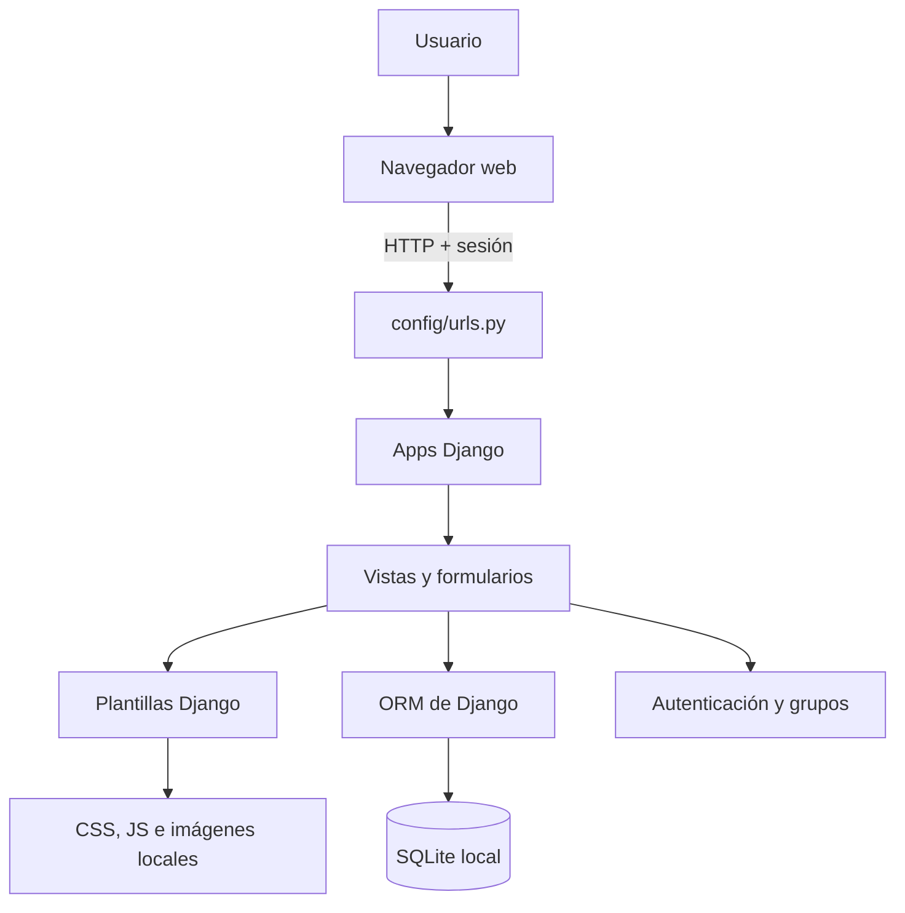
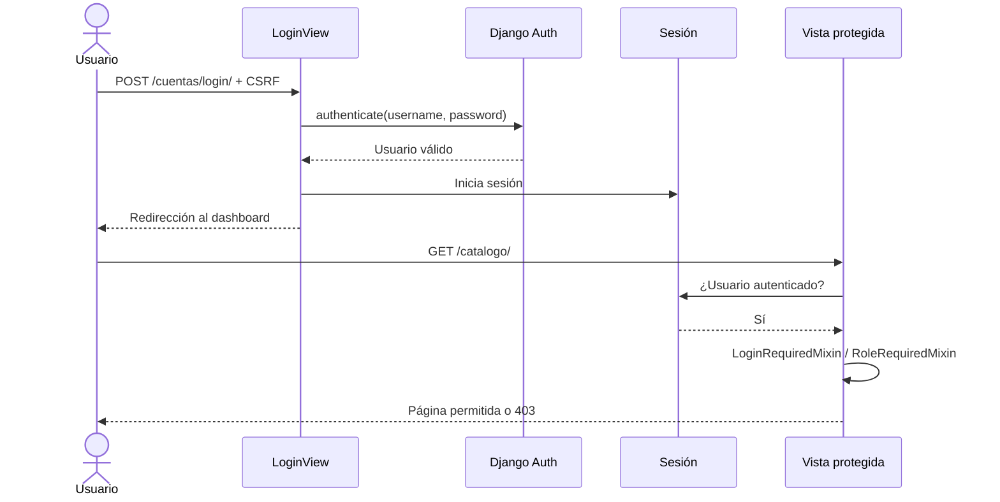

# Arquitectura — Farmacia Lufar

**Estado:** base funcional con autenticación y módulo de clientes (registro y consulta). Las demás apps siguen en estructura inicial.

## 1. Visión general

Farmacia Lufar será un sistema web local construido como un **monolito modular con Django**, usando el patrón MVT (Modelo–Vista–Plantilla) y renderizado del lado del servidor. La interfaz no depende de una SPA, de una API REST independiente ni de CDN.

## 2. Responsabilidad de las aplicaciones

| App | Responsabilidad | Estado inicial |
|---|---|---|
| `core` | Dashboard, mixins, filtros y utilidades compartidas. No contiene modelos de negocio. | Implementado como base |
| `accounts` | Login, logout, perfil, grupos `Administrador` y `Vendedor`, autorización por rol. | Base funcional |
| `catalogo` | Categorías, productos, presentaciones y precios. | Solo estructura y ruta |
| `inventario` | Existencias, lotes y movimientos de entrada, salida y ajuste. | Solo estructura y ruta |
| `compras` | Proveedores, compras, detalle y recepción de mercadería. | Solo estructura y ruta |
| `clientes` | Datos de clientes e historial comercial. | Registro y consulta implementados |
| `ventas` | Ventas, detalles, pagos y comprobantes. | Solo estructura y ruta |
| `reportes` | Consultas e informes de solo lectura. No tendrá modelos propios. | Solo estructura y ruta |

### Decisión sobre proveedores

El alcance menciona proveedores, pero define ocho aplicaciones y no incluye una app `proveedores`. Para no crear una novena app sin necesidad, el modelo `Proveedor` pertenecerá a `compras`, que es el contexto donde se usa. Si en el futuro la gestión de proveedores crece de forma independiente, podrá extraerse con una migración planificada. Ver `docs/adr/ADR-004-proveedores-en-compras.md`.

## 3. Autenticación y autorización

- Se usa el modelo `User` integrado de Django. No se crea un modelo de usuario propio en esta etapa.
- Los grupos base se crean mediante la migración `accounts.0001_create_default_groups`.
- `LoginRequiredMixin` protege todas las vistas de gestión. Las vistas de clientes usan este mixin en esta etapa.
- `RoleRequiredMixin` permite restringir una vista a grupos concretos. Los superusuarios siempre tienen acceso.
- Los permisos por modelo se asignarán a los grupos cuando existan los modelos de cada app. El modelo `Cliente` ya existe, pero sus permisos por rol todavía no se aplican.
- El login y el logout usan las vistas de Django y protección CSRF. El logout solo acepta POST.

## 4. Límites entre módulos

Estas reglas buscan evitar dependencias circulares y duplicación de lógica:

1. Cada app es dueña de sus modelos, migraciones, formularios, vistas, URLs y pruebas.
2. Las referencias entre modelos se harán con cadenas (`"catalogo.Producto"`) para evitar importaciones circulares.
3. `catalogo` es dueño del maestro de productos. `inventario` referencia productos, pero no modifica sus datos maestros.
4. `inventario` es el único módulo que debe alterar existencias. Compras y ventas deberán solicitar movimientos a través de una función de servicio transaccional.
5. `compras` es dueño de `Proveedor`, `Compra` y `DetalleCompra`.
6. `clientes` es dueño de `Cliente`. `ventas` podrá referenciarlo, pero no modificar sus datos maestros.
7. `ventas` es dueño de `Venta`, `DetalleVenta` y `Pago`.
8. `reportes` solo consulta; no debe escribir datos ni crear dependencias inversas.
9. `core` contiene infraestructura compartida, no reglas de negocio de otros módulos.
10. Las operaciones que afecten varias tablas (venta + inventario, compra + inventario) se ejecutarán dentro de `transaction.atomic()` y con bloqueo de stock cuando corresponda.
11. Las vistas deben mantenerse delgadas. Cuando una operación tenga varias reglas, se extraerá a un servicio del módulo correspondiente.

## 5. Convenciones del equipo

- **Idioma:** nombres de dominio y textos de interfaz en español; APIs y conceptos propios de Django en inglés. Evitar tildes en identificadores de código (`Categoria`, no `Categoría`).
- **Modelos:** nombres en singular (`Producto`, `Compra`, `Venta`) y `related_name` explícitos en las relaciones.
- **URLs:** namespace por app (`catalogo:index`, `ventas:index`). Los nombres de ruta se mantienen estables.
- **Plantillas:** una carpeta por app dentro de `templates/`; los componentes compartidos van en `templates/includes/`.
- **Formularios:** validación del lado del servidor con `forms.ModelForm` o `forms.Form`; no confiar en la validación del navegador.
- **Estilos y scripts:** archivos locales en `static/`. No agregar CDN ni fuentes externas.
- **Migraciones:** una app por migración lógica; no editar migraciones ya aplicadas; crear una nueva para corregir.
- **Pruebas:** cada app tendrá pruebas propias; las pruebas transversales viven en `tests/`. Toda regla de negocio nueva debe incluir pruebas.
- **Seguridad:** toda vista de gestión debe ser autenticada; toda escritura debe usar POST + CSRF; no se guardan contraseñas ni secretos en el repositorio.
- **Git:** una rama por funcionalidad, PR hacia `develop` y revisión del otro desarrollador.

## 6. Base de datos y migraciones

La base inicial es SQLite (`db.sqlite3`), ignorada por Git. SQLite es suficiente para el desarrollo local y una única instancia, pero tiene limitaciones de concurrencia. Si el sistema se despliega para varios usuarios simultáneos, se evaluará PostgreSQL antes de la puesta en producción.

La migración `clientes.0001_initial` crea la tabla `Cliente` con sus restricciones de documento. Las siguientes etapas deben crear los modelos en este orden sugerido para respetar dependencias:

1. `catalogo`: `Categoria`, `Producto`.
2. `inventario`: existencias y movimientos, referenciando `catalogo.Producto`.
3. `clientes`: `Cliente` (registro y consulta implementados).
4. `compras`: `Proveedor`, `Compra`, `DetalleCompra`.
5. `ventas`: `Venta`, `DetalleVenta`, `Pago`.
6. `reportes`: consultas sin modelos.

## 7. Roadmap sugerido

| Fase | Entregable | Dependencias |
|---|---|---|
| 1 | Catálogo con CRUD y pruebas | `accounts`, `core` |
| 2 | Inventario y movimientos transaccionales | Fase 1 |
| 3 | Clientes: registro y consulta (implementado) | `accounts` |
| 4 | Compras, proveedores y recepción | Fases 1 y 2 |
| 5 | Ventas, pagos y salida de inventario | Fases 1, 2 y 3 |
| 6 | Reportes de ventas, compras y stock | Fases 2, 4 y 5 |
| 7 | Endurecimiento de seguridad, backups y despliegue | Todas |

### Reparto sugerido para dos desarrolladores

- **Desarrollador A:** `catalogo`, `inventario`, `compras`.
- **Desarrollador B:** `clientes`, `ventas`, `reportes`.
- **Cambios compartidos:** `core` y `accounts` requieren revisión del otro desarrollador.
- Las integraciones entre ventas/compras e inventario se acuerdan antes de implementarse y se prueban en una rama conjunta.

## 8. Decisiones registradas

- [ADR-001: Monolito modular con Django MVT](adr/ADR-001-arquitectura-monolitica-modular.md)
- [ADR-002: User integrado y autorización por grupos](adr/ADR-002-user-integrado-y-grupos.md)
- [ADR-003: SQLite y operación local sin CDN](adr/ADR-003-sqlite-local-sin-cdn.md)
- [ADR-004: Proveedores dentro de compras](adr/ADR-004-proveedores-en-compras.md)
- [ADR-005: Registro y consulta de clientes](adr/ADR-005-clientes-registro-consulta.md)
