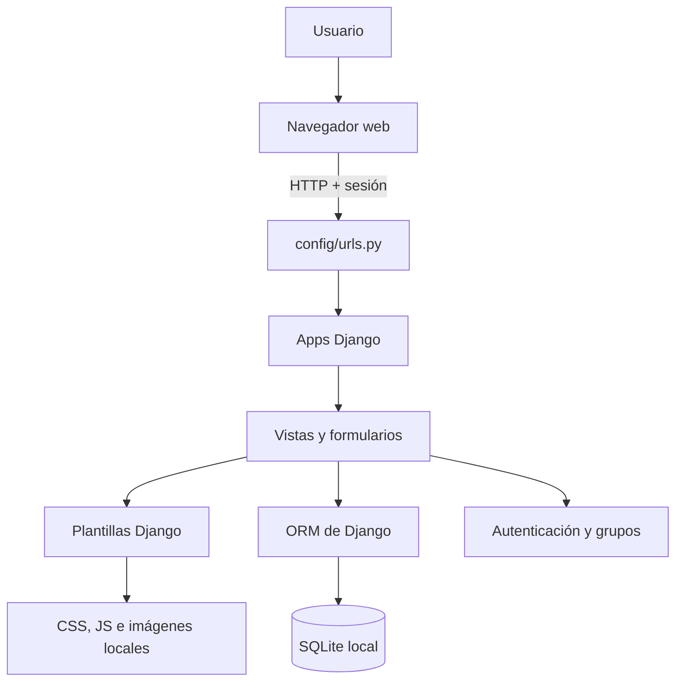
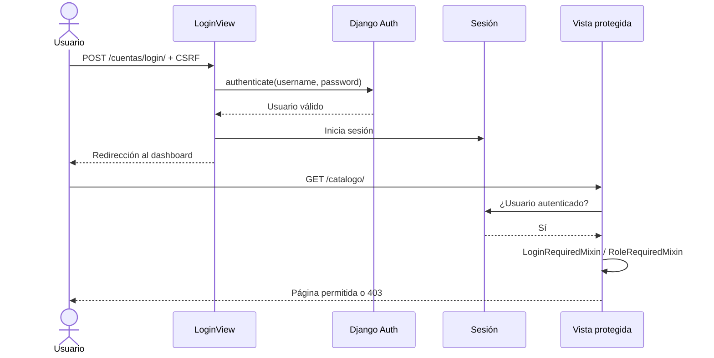
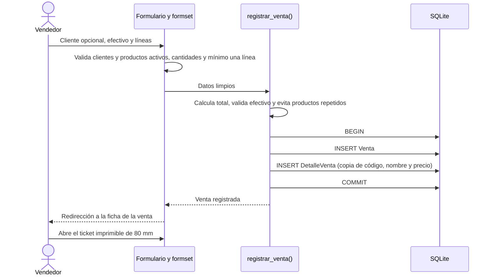
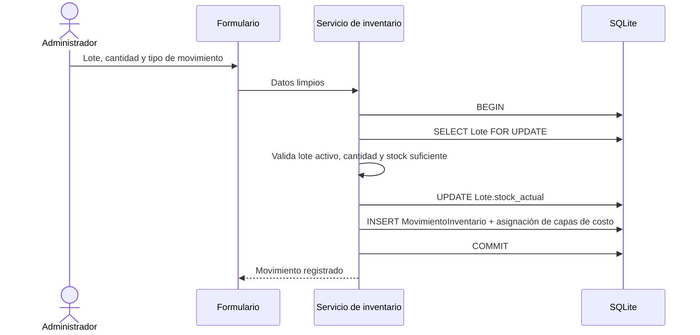
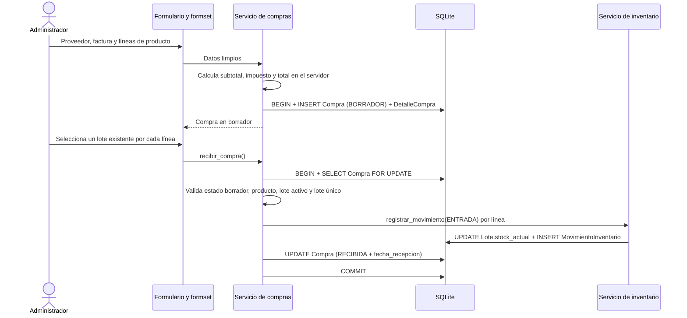

# Arquitectura — Farmacia Lufar

**Estado:** base funcional con autenticación y gestión de usuarios/roles, catálogo, inventario por lotes con costeo, clientes, ventas con descuento automático de stock, compras con recepción de inventario y reportes de ventas, compras e inventario con ganancia bruta.

## 1. Visión general

Farmacia Lufar será un sistema web local construido como un **monolito modular con Django**, usando el patrón MVT (Modelo–Vista–Plantilla) y renderizado del lado del servidor. La interfaz no depende de una SPA, de una API REST independiente ni de CDN.

## 2. Responsabilidad de las aplicaciones

| App | Responsabilidad | Estado |
|---|---|---|
| `core` | Dashboard, mixins, filtros, utilidades compartidas y `ConfiguracionSistema`. No contiene entidades de negocio. | Base implementada |
| `accounts` | Login, logout, perfil, usuarios, grupos `Administrador` y `Vendedor`, permisos por modelo y autorización por rol. | Implementado |
| `catalogo` | Categorías, laboratorios, formas farmacéuticas, presentaciones, productos y precios. | CRUD visual de productos y categorías implementado; catálogos auxiliares en admin |
| `inventario` | Existencias, lotes y movimientos de entrada, salida y ajuste. | Existencias, CRUD de lotes, movimientos y alertas implementados |
| `compras` | Proveedores, compras, detalle y recepción de mercadería. | Proveedores, borradores, recepción y anulación implementados |
| `clientes` | Datos de clientes e historial comercial. | Registro, consulta e historial implementados |
| `ventas` | Ventas, detalles, cálculo de totales, cambio y ticket. | Registro, consulta y ticket implementados |
| `reportes` | Consultas e informes de solo lectura. No tendrá modelos propios. | Reportes de ventas, compras e inventario implementados |

### Decisión sobre proveedores

El alcance menciona proveedores, pero define ocho aplicaciones y no incluye una app `proveedores`. Para no crear una novena app sin necesidad, el modelo `Proveedor` pertenece a `compras`, que es el contexto donde se usa. Si en el futuro la gestión de proveedores crece de forma independiente, podrá extraerse con una migración planificada. Ver `docs/adr/ADR-004-proveedores-en-compras.md`.

## 3. Autenticación y autorización

- Se usa el modelo `User` integrado de Django. No se crea un modelo de usuario propio en esta etapa.
- Los grupos base se crean mediante la migración `accounts.0001_create_default_groups`.
- `apps/accounts/permissions.py` es la fuente de verdad de la autorización:
  `MODULE_ACCESS` define qué módulos ve cada rol, `MANAGED_APPS` limita las apps
  cuyos permisos se sincronizan y `SELLER_PERMISSIONS` fija el menor privilegio
  del Vendedor.
- `sync_role_permissions()` se conecta a `post_migrate` desde
  `AccountsConfig.ready()` y también se ejecuta con
  `python manage.py sync_roles`. Asigna al Administrador todos los permisos de
  `catalogo`, `compras`, `inventario`, `clientes` y `ventas`, y al Vendedor solo
  los codenames declarados en `SELLER_PERMISSIONS`. La operación es idempotente y
  conserva permisos personalizados ajenos a las apps gestionadas.
- `RoleRequiredMixin` exige autenticación y pertenencia a un grupo permitido.
  Los superusuarios siempre tienen acceso y un usuario autenticado sin el rol
  recibe `403`.
- Matriz de acceso: el Vendedor usa panel general, catálogo (consulta),
  clientes, ventas y reporte de ventas. Inventario, compras, reportes de
  compras/inventario y gestión de usuarios son exclusivos del Administrador.
- La gestión visual de usuarios vive en `accounts` (`usuario_crear`,
  `usuario_editar`, `usuario_estado`). No hay eliminación: solo activación y
  desactivación. Se protege la propia cuenta, el último administrador activo y
  la edición de superusuarios por parte de administradores no superusuarios.
- El login y el logout usan las vistas de Django y protección CSRF. El logout solo acepta POST.

## 4. Límites entre módulos

Estas reglas buscan evitar dependencias circulares y duplicación de lógica:

1. Cada app es dueña de sus modelos, migraciones, formularios, vistas, URLs y pruebas.
2. Las referencias entre modelos se harán con cadenas (`"catalogo.Producto"`) para evitar importaciones circulares.
3. `catalogo` es dueño del maestro de productos. `inventario` referencia productos, pero no modifica sus datos maestros.
4. `inventario` es el único módulo que altera existencias. `crear_lote()` y `registrar_movimiento()` gestionan altas y movimientos; `consumir_stock_producto()` aplica la salida FEFO solicitada por ventas. Compras y ventas usan estos servicios dentro de sus transacciones.
5. `compras` es dueño de `Proveedor`, `Compra` y `DetalleCompra`.
6. `clientes` es dueño de `Cliente`. `ventas` podrá referenciarlo, pero no modificar sus datos maestros.
7. `ventas` es dueño de `Venta` y `DetalleVenta`. En esta etapa el único medio de pago es efectivo, por lo que no existe un modelo `Pago` separado.
8. `reportes` solo consulta; no debe escribir datos ni crear dependencias inversas.
9. `core` contiene infraestructura compartida, no reglas de negocio de otros módulos.
10. Las operaciones que afecten varias tablas (venta + inventario, compra + inventario) se ejecutarán dentro de `transaction.atomic()` y con bloqueo de stock cuando corresponda.
11. Las vistas deben mantenerse delgadas. Cuando una operación tenga varias reglas, se extraerá a un servicio del módulo correspondiente. El registro de ventas usa `apps/ventas/services.py`.
12. `catalogo` es dueño del precio de venta; `ventas` guarda una copia histórica en `DetalleVenta` junto al costo real de adquisición consumido y no modifica el producto.

## 5. Flujo de venta

Reglas de esta etapa:

- El cliente es opcional; si no se selecciona, la venta queda como
  **Consumidor final**.
- El precio unitario se toma del catálogo y se copia al detalle. El navegador no
  puede modificarlo.
- El pago es solo en efectivo. El total y el cambio se calculan en el servidor.
- La venta es inmutable: no se edita, elimina ni anula desde la interfaz.
- El servicio de ventas crea los detalles y consume inventario dentro de la
  misma transacción. El consumo sigue FEFO entre lotes activos no vencidos y
  FIFO entre capas de costo de cada lote; si no hay stock suficiente, se
  revierte toda la venta.
- Cada detalle conserva el costo de adquisición asignado al consumo. Si el
  costo es desconocido por tratarse de inventario heredado sin precio, el costo
  queda vacío y la venta no se incluye en la ganancia reportada hasta completar
  su costo.
- El ticket se genera como HTML imprimible de 80 mm con CSS `@media print`; no
  se usa una librería PDF.

## 6. Flujo de inventario

Reglas de esta etapa:

- `Lote` es la unidad de existencia. El stock no se guarda en `Producto`; el
  producto solo define el umbral `stock_minimo`.
- `crear_lote()` crea el lote con stock cero y, si se indica stock inicial,
  registra un movimiento `INICIAL` dentro de la misma transacción.
- `registrar_movimiento()` bloquea el lote con `select_for_update()`, valida que
  esté activo y aplica el signo del movimiento:
  `ENTRADA` y `AJUSTE_POSITIVO` suman; `SALIDA` y `AJUSTE_NEGATIVO` restan. El
  stock resultante nunca puede ser negativo.
- Cada entrada con costo genera una capa de costo vinculada al movimiento. Las
  ventas asignan cantidades a esas capas y conservan el costo usado en cada
  salida. La compra recibida transmite el costo unitario registrado en su
  detalle.
- `crear_lote()` requiere costo unitario cuando se carga stock inicial. Los
  lotes existentes se migran con capas de costo desconocido, sin estimar ni
  inventar precios; el administrador puede completar el costo de existencias
  pendientes desde la edición del lote.
- El tipo `INICIAL` no se ofrece en el formulario manual; solo lo genera el alta
  del lote para evitar duplicar la carga inicial.
- `MovimientoInventario` es inmutable: no se edita ni se elimina desde la
  interfaz y su admin es de solo lectura. El admin de lotes también trata
  `stock_actual` como campo de solo lectura.
- Un lote con existencias no puede desactivarse. La regla se valida en el
  modelo y en la vista de cambio de estado.
- `apps/inventario/selectors.py` centraliza `stock_por_producto()` y
  `productos_con_stock_bajo()`. Las alertas comparan el total de lotes activos
  con `stock_minimo` usando `<=`, igual que el reporte de inventario.
- El listado de existencias busca por producto, filtra por estado y por alerta
  (stock bajo, sin stock, por vencer o vencido). El listado de lotes agrega
  búsqueda y filtro de vencimiento; el historial de movimientos filtra por tipo
  y texto.

## 7. Flujo de compras

Reglas de esta etapa:

- `Proveedor`, `Compra` y `DetalleCompra` viven en `compras`. El NIT es opcional
  pero único cuando se informa, sin distinguir mayúsculas.
- Una compra nace en `BORRADOR`. Solo los borradores se editan o anulan; una
  compra `RECIBIDA` es inmutable y una `ANULADA` no vuelve a borrador.
- Los totales son autoritativos del servidor:
  `subtotal = Σ(cantidad × costo_unitario)` y `total = subtotal + impuesto`.
  El formulario no envía `subtotal` ni `total`.
- Se permite repetir un producto en varias líneas para asignarle lotes distintos
  en la recepción.
- La recepción exige un lote existente, activo y del mismo producto por cada
  línea. No crea lotes; si faltan, se crean desde `inventario`.
- La recepción es atómica: valida todas las líneas antes de registrar
  movimientos y usa `registrar_movimiento()` con tipo `ENTRADA` y un motivo que
  incluye el número de compra. Si una línea falla, no queda ninguna entrada.
- No se eliminan proveedores, compras ni detalles. Los proveedores se
  desactivan con `activo`; las compras recibidas o anuladas son de solo lectura
  también en Django Admin.

## 8. Convenciones del equipo

- **Idioma:** nombres de dominio y textos de interfaz en español; APIs y conceptos propios de Django en inglés. Evitar tildes en identificadores de código (`Categoria`, no `Categoría`).
- **Modelos:** nombres en singular (`Producto`, `Compra`, `Venta`) y `related_name` explícitos en las relaciones.
- **URLs:** namespace por app (`catalogo:index`, `ventas:index`). Los nombres de ruta se mantienen estables.
- **Plantillas:** una carpeta por app dentro de `templates/`; los componentes compartidos van en `templates/includes/`.
- **Formularios:** validación del lado del servidor con `forms.ModelForm` o `forms.Form`; no confiar en la validación del navegador.
- **Estilos y scripts:** archivos locales en `static/`. No agregar CDN ni fuentes externas.
- **Migraciones:** una app por migración lógica; no editar migraciones ya aplicadas; crear una nueva para corregir.
- **Pruebas:** cada app tendrá pruebas propias; las pruebas transversales viven en `tests/`. Toda regla de negocio nueva debe incluir pruebas.
- **Seguridad:** toda vista de gestión debe ser autenticada; los módulos
  restringidos usan `RoleRequiredMixin`; toda escritura debe usar POST + CSRF;
  no se guardan contraseñas ni secretos en el repositorio.
- **Git:** una rama por funcionalidad, PR hacia `develop` y revisión del otro desarrollador.

## 9. Base de datos y migraciones

La base inicial es SQLite (`db.sqlite3`), ignorada por Git. SQLite es suficiente para el desarrollo local y una única instancia, pero tiene limitaciones de concurrencia. Si el sistema se despliega para varios usuarios simultáneos, se evaluará PostgreSQL antes de la puesta en producción.

El esquema ya cubre el modelo relacional completo: `clientes` (Cliente), `catalogo` (Categoria, Laboratorio, FormaFarmaceutica, Presentacion y Producto), `ventas` (Venta y DetalleVenta), `inventario` (Lote y MovimientoInventario), `compras` (Proveedor, Compra y DetalleCompra) y `core` (ConfiguracionSistema). El detalle de tablas, claves y restricciones está en `docs/modelo-er-relacional.pdf`.

Quedan pendientes las capas de servicio y las vistas:

1. `ventas`: integrar la salida de inventario en `registrar_venta`, definiendo
   la selección de lotes (por ejemplo, FEFO).

## 10. Roadmap sugerido

| Fase | Entregable | Dependencias |
|---|---|---|
| 0 | Autenticación, usuarios, roles y permisos por modelo (implementado) | — |
| 1 | Catálogo con CRUD visual de productos y categorías (implementado) | `accounts`, `core` |
| 2 | Inventario: existencias, lotes, movimientos y alertas (implementado) | Fase 1 |
| 3 | Clientes: registro, consulta e historial (implementado) | `accounts` |
| 4 | Compras, proveedores y recepción (implementado) | Fases 1 y 2 |
| 5 | Ventas: registro, total, cambio y ticket (implementado); salida de inventario pendiente | Fases 1, 2 y 3 |
| 6 | Reportes de ventas, compras y stock (implementado) | Fases 2, 4 y 5 |
| 7 | Endurecimiento de seguridad, backups y despliegue | Todas |

### Reparto sugerido para dos desarrolladores

- **Desarrollador A:** `catalogo`, `inventario`, `compras`.
- **Desarrollador B:** `clientes`, `ventas`, `reportes`.
- **Cambios compartidos:** `core` y `accounts` requieren revisión del otro desarrollador.
- Las integraciones entre ventas/compras e inventario se acuerdan antes de implementarse y se prueban en una rama conjunta.

## 11. Decisiones registradas

- [ADR-001: Monolito modular con Django MVT](adr/ADR-001-arquitectura-monolitica-modular.md)
- [ADR-002: User integrado y autorización por grupos](adr/ADR-002-user-integrado-y-grupos.md)
- [ADR-003: SQLite y operación local sin CDN](adr/ADR-003-sqlite-local-sin-cdn.md)
- [ADR-004: Proveedores dentro de compras](adr/ADR-004-proveedores-en-compras.md)
- [ADR-005: Registro y consulta de clientes](adr/ADR-005-clientes-registro-consulta.md)
- [ADR-006: Ventas con catálogo mínimo y ticket HTML](adr/ADR-006-ventas-catalogo-minimo-ticket.md)
- [ADR-007: Catálogo visual de productos y categorías](adr/ADR-007-catalogo-visual-productos-categorias.md)
- [ADR-008: Inventario por lotes con movimientos transaccionales](adr/ADR-008-inventario-lotes-movimientos.md)
- [ADR-009: Compras, proveedores y recepción sobre lotes](adr/ADR-009-compras-proveedores-recepcion.md)
